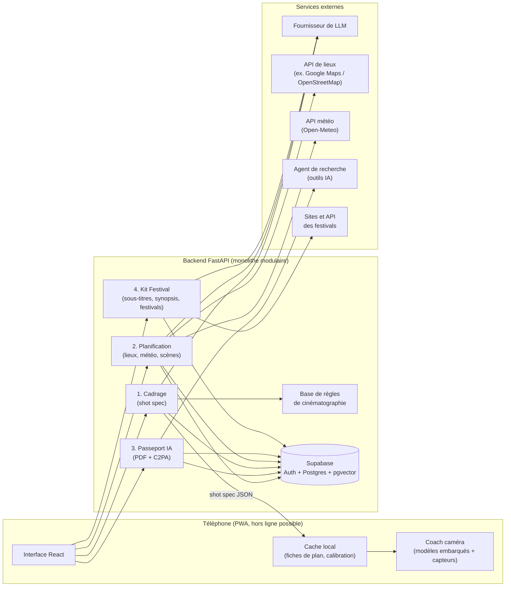
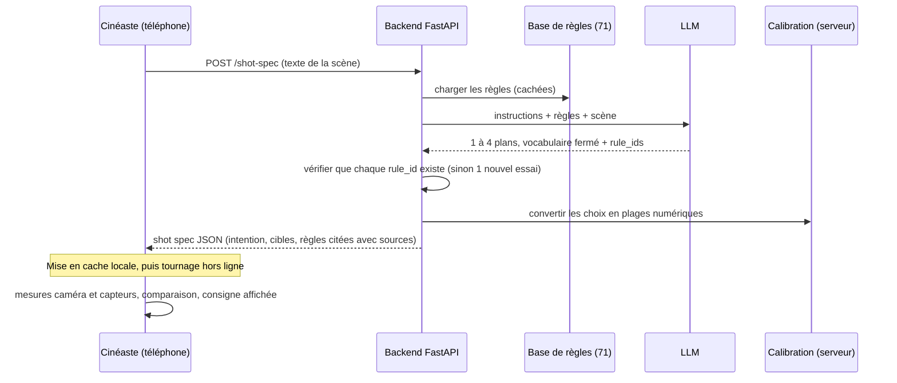

# Premier Plan

> **FilmFreeway t'aide à envoyer ton film. Premier Plan t'aide à ce qu'il soit prêt, sous-titré, et honnête sur l'IA.**

Premier Plan est une plateforme web (PWA, utilisable sur téléphone) qui accompagne un jeune cinéaste tunisien **du premier plan jusqu'au festival**, sans faire le travail à sa place, et qui lui permet de **prouver ce qui est humain et ce qui est IA** dans son film.

Projet réalisé pour le hackathon **IA Éthique 360** (Junior Entreprise INSAT et OIF), sous-thème : *l'IA dans l'audiovisuel culturel*.

---

## Sommaire

1. [Le problème et notre positionnement](#1-le-problème-et-notre-positionnement)
2. [Vue d'ensemble de l'architecture](#2-vue-densemble-de-larchitecture)
3. [Les quatre modules](#3-les-quatre-modules)
4. [Module 1 en détail : le Coach de cadrage](#4-module-1-en-détail--le-coach-de-cadrage)
5. [Données et vie privée](#5-données-et-vie-privée)
6. [Éthique 360 : nos engagements](#6-éthique-360--nos-engagements)
7. [API](#7-api)
8. [Structure du dépôt et lancement](#8-structure-du-dépôt-et-lancement)
9. [État d'avancement et limites connues](#9-état-davancement-et-limites-connues)
10. [Feuille de route](#10-feuille-de-route)
11. [Équipe et crédits](#11-équipe-et-crédits)

---

## 1. Le problème et notre positionnement

Un jeune cinéaste tunisien qui débute rencontre trois obstacles :

- **Filmer** sans mentor : cadrage, lumière, choix du lieu et du moment.
- **Utiliser l'IA sans s'en cacher** : de plus en plus de festivals demandent de déclarer l'usage d'outils d'IA, mais il n'existe pas de moyen simple de le documenter.
- **Diffuser** : sous-titres dans une autre langue, synopsis, choix d'un festival adapté.

**Notre positionnement.** Les plateformes de soumission sont des places de marché pour *envoyer* un film. Premier Plan intervient **en amont** : préparer le film, le sous-titrer, rédiger le synopsis, déclarer l'IA, puis **renvoyer vers le site officiel du festival**. **Il n'y a ni soumission ni paiement chez nous.**

**Notre principe directeur.** L'IA propose, le cinéaste décide. Toute proposition est modifiable et marquée *« Brouillon IA : à valider »*.

---

## 2. Vue d'ensemble de l'architecture

Une seule application web (PWA) côté téléphone, un seul backend **FastAPI** côté serveur, organisé en **quatre modules** (monolithe modulaire, pas de microservices).



**Principe central : deux « cerveaux ».**
- Le **serveur** réfléchit en amont (comprendre la scène, proposer un plan, vérifier des règles).
- Le **téléphone** exécute en direct et **hors ligne** (mesurer l'image et les capteurs, comparer à la fiche de plan, afficher une consigne).

### Technologies

| Couche | Choix |
|---|---|
| Front | React, Vite, Tailwind, PWA (service worker, cache hors ligne) |
| Caméra et mesures | `getUserMedia`, `DeviceMotion`/`DeviceOrientation`, canvas, Web Audio, MediaPipe Tasks Vision |
| Backend | Python 3.12, FastAPI, Pydantic v2, `uvicorn`, `structlog` |
| Base de données | Supabase (authentification, Postgres, pgvector pour la recherche par similarité) |
| LLM | API Anthropic (sorties structurées validées par Pydantic) |
| Météo et soleil | Open-Meteo, SunCalc |
| Passeport | WeasyPrint ou ReportLab (PDF), `c2patool` (C2PA) |
| Déploiement | Vercel (front), Render ou Railway (backend), HTTPS obligatoire pour la caméra |

---

## 3. Les quatre modules

### Module 1 : Coach de cadrage *(en cours de construction)*

**Rôle.** À partir d'une description de scène, le serveur propose une **fiche de plan** (taille de plan, angle, lumière, position du sujet). Ensuite, sur le téléphone, la caméra s'ouvre et le Coach compare l'image en direct à cette fiche pour donner des consignes (« Élève de 5° »).

**Idée clé.** Le serveur ne produit **aucun nombre inventé** : il choisit dans un vocabulaire fermé, puis le backend convertit ces choix en plages numériques. Le téléphone n'a plus qu'à mesurer et comparer, sans réseau.

Détail complet : [section 4](#4-module-1-en-détail--le-coach-de-cadrage).

### Module 2 : Planification assistée par IA *(prévu)*

**Rôle.** Aider à choisir **où et quand** tourner chaque scène.

**Flux prévu.**
1. Le cinéaste fournit un scénario ou une description.
2. Un **découpeur** (*chunker*) segmente le texte en **scènes**.
3. Chaque scène est envoyée au moteur de suggestion.
4. Le moteur interroge une **base de lieux** (RAG) : pour chaque lieu, une description, des coordonnées et des **scores d'ambiance** ("vibes") produits par notre équipe. La recherche combine la similarité sémantique (pgvector) avec des filtres.
5. Une **API de lieux** (Google Maps ou une alternative libre comme OpenStreetMap) enrichit les résultats : adresse, accès, horaires.
6. Une **API météo** (Open-Meteo) et **SunCalc** classent les créneaux : météo, heure, direction du soleil.
7. Le résultat est renvoyé comme **suggestion modifiable** : lieu, créneau, et une fiche de plan par scène (réutilise le Module 1).

**Honnêteté sur les données.** Le jeu de données des lieux et de leurs scores d'ambiance doit être **constitué et vérifié par l'équipe** ; nous n'utilisons aucun score inventé. Sans source, un lieu n'est pas affiché.

### Module 3 : Passeport IA *(prévu)*

**Rôle.** Permettre au cinéaste de **déclarer** les outils d'IA utilisés et de produire une preuve vérifiable.

**Flux prévu.**
1. Le cinéaste liste les outils d'IA utilisés (et ce qu'il a **décidé lui-même**).
2. Le backend interroge un **agent de recherche** pour retrouver la documentation publique de chaque outil (politique d'entraînement, conditions d'usage), et notre **jeu de données** d'outils déjà documentés.
3. Chaque outil reçoit un statut : **Documenté**, **Partiel** ou **Non divulgué**. « Non divulgué » est un statut valide.
4. Le backend génère un **PDF** (WeasyPrint/ReportLab) et une **signature C2PA** (`c2patool`).
5. Une **page de vérification** publique permet à un festival de contrôler le passeport.

**Ce que le Passeport ne dit jamais.** Il ne déclare jamais un film « légal » ou « sûr ». Mention obligatoire : *« Déclaration fondée sur la documentation publique. Ce n'est pas un avis juridique. »*

**Point technique à noter.** Une signature C2PA reconnue publiquement exige un certificat délivré par une autorité de confiance. Pour la démonstration, nous utiliserons un certificat de test, et nous le dirons.

### Module 4 : Kit Festival *(en cours de définition)*

Trois fonctions :

- **Sous-titres** derja vers français et anglais, **validés ligne par ligne** par le cinéaste. *Choix technique encore ouvert* : la derja est une langue peu dotée en outils, la qualité de la reconnaissance automatique n'est pas garantie. Nous évaluerons les options (transcription fournie par l'utilisateur, ou reconnaissance vocale testée sur nos propres extraits) avant de nous engager. La traduction est toujours un brouillon relu par un humain.
- **Coach de synopsis** : il **pose des questions** et ne réécrit pas le texte.
- **Trouver mon festival** : recherche, filtres et classement expliqué.
  - Le classement indique la **compatibilité avec les critères** du festival ; **il ne prédit pas la sélection**.
  - Chaque fiche festival porte une **source et une date de vérification**, sinon elle n'est pas affichée.
  - Données : une base de festivals **vérifiée à la main**. Le lien avec l'extérieur sera fait par **appels d'API classiques** quand un festival en propose, sinon par saisie vérifiée. Un connecteur **MCP** reste une option si elle apporte un vrai bénéfice ; nous ne l'annonçons pas tant qu'elle n'est pas testée.

---

## 4. Module 1 en détail : le Coach de cadrage

### 4.1 Flux de bout en bout



### 4.2 Couche d'ingénierie du prompt et contexte

Le serveur n'entraîne ni ne fine-tune aucun modèle. Il **guide** un LLM par :

- **Des instructions fixes** : rôle, principes (« tu proposes, le cinéaste décide »), interdiction d'inventer des chiffres, obligation de citer des règles.
- **Une base de 71 règles de cinématographie** (`backend/rules/rules.json`) : tailles de plan, cadrage, horizon, angles, lumière, continuité, mouvements, smartphone, son, documentaire. Chaque règle a un identifiant, un texte, un « pourquoi », les mesures du téléphone concernées, un **niveau de confiance** et **au moins une source**. Une règle sans source est refusée par le schéma de validation.
- **Toutes les règles dans le prompt** (environ 4 750 tokens, estimation par nombre de caractères), mises en **cache**. À cette taille, c'est plus fiable qu'une recherche par similarité. La fonction `select_rules()` est le **point d'extension** vers un vrai RAG (embeddings) quand la base grandira.
- **Une sortie structurée** : la réponse du LLM est contrainte par un schéma Pydantic puis validée.
- **Un contrôle anti-invention** : chaque plan doit citer des `rule_id` qui existent réellement. Sinon, un nouvel essai, puis une erreur claire.
- **Une protection contre l'injection** : le texte de la scène est balisé comme donnée à analyser, jamais comme instruction.

### 4.3 Le contrat « shot spec »

Pour chaque plan, deux niveaux :

| Niveau | Contenu | Produit par |
|---|---|---|
| **Intention** | taille de plan, sujet et vue (face, profil, dos), position (tiers gauche/centre/tiers droit), angle (hauteur des yeux, plongée, contre-plongée), horizon (droit ou penché), contraste, exposition, contre-jour, position du soleil, stabilité, mouvement, conseils texte | le LLM, avec un vocabulaire fermé |
| **Cibles numériques** | plages pour : inclinaison de l'horizon, angle haut/bas, taille du sujet, espace au-dessus de la tête, luminosité, contraste, rapport de contre-jour, écart de cap avec le soleil, tremblement | le serveur, via `calibration.py` |

La réponse inclut aussi les **règles citées avec leurs sources**, et la mention *« Brouillon IA : à valider »*.

**Pourquoi un vocabulaire fermé plutôt que des nombres du LLM ?** Les LLM sont peu fiables pour produire des valeurs numériques calibrées. En ne leur demandant que des choix sémantiques, nous gardons le contrôle des nombres, nous pouvons les calibrer sur le terrain, et chaque choix correspond à une mesure que le téléphone sait réellement faire.

**Calibration.** Les valeurs numériques actuelles sont des **réglages de départ (v0)**, choisis par l'équipe, et **non des faits issus de sources**. Elles seront calibrées par des essais de tournage. La version est indiquée dans chaque réponse (`calibration: "v0-default"`). Seuls les tiers (1/3) et l'emplacement des yeux au tiers supérieur s'appuient sur des règles sourcées de notre base.

### 4.4 Modèles et capteurs embarqués (sur le téléphone)

Le Coach fonctionne **sur l'appareil, sans réseau**. **Nous n'entraînons aucun modèle** : nous utilisons des modèles pré-entraînés légers (quelques Mo), mis en cache par le service worker.

| Besoin | Moyen | Type |
|---|---|---|
| Où est le visage, quelle taille, quelle position | **Détection de visage** MediaPipe (BlazeFace) | modèle pré-entraîné |
| Personne de dos ou de profil, taille du corps | **Estimation de pose** MediaPipe (version légère) | modèle pré-entraîné |
| Inclinaison de l'horizon (roulis), angle haut/bas (tangage) | **Capteurs de mouvement** (gravité) avec lissage | calcul, sans IA |
| Direction de la caméra par rapport au soleil | **Boussole** de l'appareil + position du soleil calculée par **SunCalc** | calcul, sans IA |
| Luminosité, contraste, contre-jour, surexposition | analyse d'une image réduite en niveaux de gris | calcul, sans IA |
| Netteté | variance du laplacien | calcul, sans IA |
| Tremblement | variation du gyroscope | calcul, sans IA |
| Niveau sonore | Web Audio | calcul, sans IA |

**À propos de « reconnaissance de visage ».** Nous faisons de la **détection** (savoir *où* se trouve un visage dans l'image), **jamais de l'identification** (savoir *qui* est la personne). Aucun visage n'est reconnu, stocké ni comparé à une base. Cela fait partie de nos engagements éthiques.

**Moteur de règles sur l'appareil.** Une fonction pure compare les mesures aux cibles : elle calcule l'écart normalisé de chaque mesure, choisit **une seule consigne à la fois** par priorité (stabilité, puis cadrage, puis exposition), avec **anti-rebond** (la condition doit durer un instant), **délai entre deux messages** et **hystérésis** pour éviter le clignotement. Les consignes sont des **gabarits** : une illustration en cache et un texte dont seul le nombre change en direct.

**Hors ligne.** La fiche de plan et les tables de calibration sont mises en cache sur le téléphone ; les modèles sont embarqués. Les tournages en extérieur n'ont pas besoin de réseau.

**Ce qui n'est pas mesurable, et que nous disons.** La hauteur réelle de la caméra en mètres, la qualité du son au-delà d'un niveau grossier, l'intention artistique. Ces points restent des **conseils texte**.

**Limites de la PWA.** Sur iPhone, une PWA ne donne pas le contrôle fin de l'exposition ni du choix d'objectif, et ne peut pas se superposer à l'application Caméra native. Le Coach sert surtout à **vérifier et verrouiller le cadre** avant d'enregistrer. Une version native (Swift) est envisagée en évolution.

---

## 5. Données et vie privée

- **Seul le texte de la scène quitte le téléphone.** Les images de la caméra sont traitées sur l'appareil, rien n'est envoyé.
- **Rétention zéro par défaut** : le serveur ne conserve rien tant que l'utilisateur n'a pas choisi de sauvegarder un projet.
- **Le texte des scènes n'est jamais écrit dans les journaux** du serveur : seuls la méthode, le chemin, la durée et un identifiant de requête sont enregistrés.
- **Pas d'entraînement sur les données** des utilisateurs.
- Le fournisseur de LLM est un sous-traitant externe : ses conditions (non-entraînement, rétention) doivent être vérifiées avant toute promesse publique. `[à confirmer avant la finale]`
- Le **droit de supprimer** : `DELETE /projects/{id}` supprime un projet sauvegardé.

---

## 6. Éthique 360 : nos engagements

1. **L'IA propose, l'humain décide.** Toute proposition est modifiable et étiquetée *« Brouillon IA : à valider »*.
2. **Transparence des sources.** Chaque règle de cadrage a une source ; chaque fiche festival a une source et une date de vérification. Sans source, rien n'est affiché.
3. **Aucune invention.** Pas de statistique, de nom de festival, de date ni de tarif inventés. Ce qui n'est pas vérifié est marqué `[à vérifier]`.
4. **Honnêteté sur l'IA.** Le Passeport accepte le statut « Non divulgué » et ne prétend jamais qu'un film est « légal » ou « sûr ».
5. **Pas de prédiction de sélection.** Le classement des festivals mesure la compatibilité avec leurs critères, pas les chances d'être sélectionné.
6. **Vie privée par conception.** Traitement sur l'appareil, rétention zéro, détection de visage sans identification.
7. **Limites assumées.** Les seuils de calibration sont des réglages de départ ; la qualité de la derja n'est pas garantie ; la signature C2PA de démonstration utilise un certificat de test.
8. **Points non vérifiés à ce jour** : la date et la portée de l'AI Act européen, et la règle du CNC. Nous ne les affirmons pas.

---

## 7. API

Documentation interactive en local : `http://localhost:8000/docs`.

| Méthode | Route | Module | État |
|---|---|---|---|
| GET | `/health` | commun | fait |
| GET | `/health/ready` | commun (test de la base) | fait |
| POST | `/shot-spec` | 1. Cadrage | fait (testé avec un faux LLM ; appel réel à valider) |
| GET | `/calibration` | 1. Cadrage (recalcul hors ligne côté client) | prévu |
| POST / GET / DELETE | `/projects`, `/projects/{id}` | commun | prévu |
| POST | `/plan/suggest` | 2. Planification | prévu |
| POST | `/passport` | 3. Passeport | prévu |
| GET | `/passport/{id}/check`, `/passport/{id}/pdf`, `/verify/{id}` | 3. Passeport | prévu |
| POST | `/c2pa/sign` | 3. Passeport | prévu |
| GET | `/festivals` | 4. Kit Festival | prévu |
| POST | `/synopsis/feedback` | 4. Kit Festival | prévu |

Les routes suivent la chaîne **route → contrôleur → service**. Les erreurs ont un format commun et ne révèlent aucun détail interne.

---

## 8. Structure du dépôt et lancement

```
hackJEI/
├── README.md
└── backend/
    ├── app/
    │   ├── main.py            application et démarrage
    │   ├── core/              configuration, journaux, erreurs
    │   ├── db/                Postgres (Supabase) et client Supabase
    │   ├── middleware/        identifiant de requête, CORS
    │   ├── routes/            déclaration des routes
    │   ├── controllers/       entrée/sortie HTTP
    │   ├── services/          logique métier (LLM, règles, calibration, shot spec)
    │   └── schemas/           modèles Pydantic (règle, shot spec, santé)
    ├── rules/                 base de 71 règles + schéma JSON
    ├── scripts/               validation des règles, export du schéma
    ├── tests/                 tests automatisés
    ├── PLAN.md                prochaines étapes du backend
    └── .env.example           variables d'environnement à remplir
```

**Lancer le backend en local**

```bash
cd backend
cp .env.example .env        # puis renseigner Supabase et la clé du fournisseur de LLM
uv run uvicorn app.main:app --reload
uv run pytest -q            # tests
```

Tester une scène :

```bash
curl -s localhost:8000/shot-spec -H 'content-type: application/json' \
  -d '{"description":"Un vieil homme boit le thé dans un café de la médina, de dos.","setting":"interior"}'
```

Valider la base de règles :

```bash
uv run python -m scripts.validate_rules rules/rules.json
```

---

## 9. État d'avancement et limites connues

| Élément | État |
|---|---|
| Squelette du backend, routes de santé, connexion Supabase | fait (connexion à tester avec de vraies clés) |
| Base de 71 règles sourcées et validation automatique | fait |
| `POST /shot-spec` : prompt, validation, conversion en cibles | fait ; **appel réel au LLM à valider** |
| Authentification et limitation de débit | à faire (la route appelle un LLM payant : ne pas l'exposer publiquement avant) |
| Projets, export de calibration en JSON | à faire |
| Coach sur téléphone (caméra, capteurs, moteur de règles) | à faire |
| Planification (lieux, météo, découpage de scénario) | à faire ; **jeu de données de lieux à constituer** |
| Passeport IA (PDF, C2PA) | à faire |
| Kit Festival (sous-titres, synopsis, festivals) | à faire ; **choix technique des sous-titres ouvert** ; **base de festivals à vérifier à la main** |

**Limites connues, assumées**
- Les **seuils numériques** du Coach sont des réglages de départ, à calibrer sur le terrain.
- Les règles de **moindre confiance** sont marquées comme telles, et plusieurs thèmes sont peu sourcés : iPhone (fréquence d'images, distorsion), documentaire en médina, son avec micro de téléphone, plan de dos. Nous les compléterons par l'expérience de terrain de l'équipe, en la citant comme telle.
- Un conseil de lumière de la base provient d'une source nord-américaine (direction du soleil dans les rues) : **à vérifier en Tunisie**.
- Aucun chiffre de performance (précision, vitesse, satisfaction) n'est annoncé : nous n'avons pas encore mené d'évaluation. Elle fera l'objet d'un protocole sur des extraits tournés par l'équipe.

---

## 10. Feuille de route

| Date | Jalon |
|---|---|
| 15 nov 2026, 23:59 (GMT+1) | Premier rendu : slides, vidéo de 1 à 2 minutes, dépôt GitHub avec ce README |
| 17 nov | Annonce du top 10 |
| 21 nov | Demi-finale |
| 24 nov | Rendu final |
| 25 nov | Finale à l'INSAT, Tunis |

**Priorités avant la finale** : valider l'appel réel au LLM, ajouter l'authentification, construire le Coach sur téléphone, calibrer les seuils sur des extraits réels, constituer la base de festivals et le jeu de données de lieux, puis le Passeport.

---

## 11. Équipe et crédits

- Équipe : `[noms et rôles à compléter]`
- Photographie d'accueil : `[source et licence à confirmer avant publication]`
- Sources des règles de cinématographie : voir le champ `sources` de chaque règle dans `backend/rules/rules.json`.
- Licence du code : `[à choisir]`
